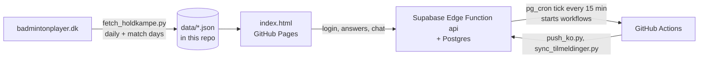

# NKB — holdkampe, kalender og tilmelding

Web app and data pipeline for **Nivå Kokkedal Badmintonklub** (badmintonplayer.dk club 1153). A copy of the HØBK app (Hørsholm Badminton Klub) with **Supabase** as the database instead of a Google Sheet.

It shows every NKB team's matches, results, lineups, standings, players and rankings — fetched automatically from badmintonplayer.dk — plus a club calendar, login with an email code, registration for matches and training, team chat, news, activities, car pool and feedback.

## How it fits together

## Setup
1. Create the GitHub repo, upload these files, turn on **Pages** (Settings → Pages → Deploy from branch `main`, `/ (root)`).
2. Set up Supabase and the secrets: **[docs/SUPABASE.md](docs/SUPABASE.md)**.
3. Run the workflow **NKB holdkampe** once (Actions → Run workflow) to fetch this season's data.
4. Training times: edit `data/traening.json` (taken from nkbadminton.dk — check season dates and holidays).

## Repository layout

| Path | Purpose |
|---|---|
| `index.html` | The whole app (HTML, CSS, JS in one file) |
| `config.json` | `registrationUrl` (Supabase function), `appUrl`, `vapidPublicKey` |
| `supabase/migrations/` | Database tables (run once in the SQL Editor) |
| `supabase/functions/api/` | The server (Edge Function) |
| `supabase/cron.sql` | Schedule (pg_cron) |
| `fetch_holdkampe.py`, `fetch_live.py` | Fetch teams, matches, lineups, standings, players, tournaments |
| `notify_turneringer.py`, `push_ko.py` | Notifications and web push |
| `sync_tilmeldinger.py` | Copies registrations (without emails) into `data/nkb.db` + `data/tilmeldinger.json` |
| `data/traening.json` | Weekly training times, season, holidays (**edited by hand**) |
| `guide.html`, `kom-i-gang.html` | User guides |

More: [docs/APP.md](docs/APP.md), [docs/DATA.md](docs/DATA.md), [docs/OPERATIONS.md](docs/OPERATIONS.md), [docs/PRIVACY.md](docs/PRIVACY.md).
